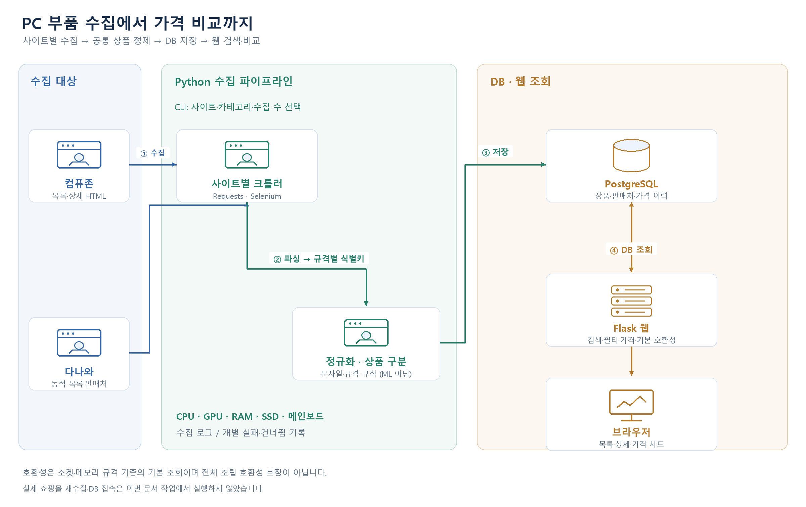

# PC 부품 크롤링·가격 비교 서비스

**컴퓨존·다나와의 PC 부품 정보를 수집하고, 규격별로 정제·저장한 뒤 웹에서 검색·가격 비교·기본 호환성을 조회하는 개인 프로젝트입니다.**

> 문서 기준: 2026-10-22 제공된 로컬 코드. GitHub에는 README·구성도·분석 문서를 먼저 반영하며, 실행 소스와 DB 스키마의 동기화는 별도입니다. 아래 실행 안내는 로컬 프로젝트 기준입니다.

## 대표 화면

실제 화면 촬영 후 추가할 예정입니다.

| 화면 | 보여줄 내용 |
|---|---|
| 상품 목록 | 카테고리·브랜드·규격 필터와 검색 |
| 상품 상세 | 판매처별 가격·가격 이력 차트 |
| 기본 호환성 | CPU 소켓·RAM 규격에 맞는 메인보드 조회 |

## 프로젝트 개요

쇼핑몰별로 상품명·상세 구조·가격 제공 방식이 달라 같은 규격을 비교하기 어렵습니다. 사이트별 수집 로직을 분리하고, 상품·규격·판매처·가격 이력을 공통 DB 구조로 연결했습니다. 학습 모델이 아닌 규칙 기반 파싱·정규화를 사용합니다.

| 항목 | 내용 |
|---|---|
| 개발 기간 | 2주 — 사용자 확인 |
| 형태 | 개인 프로젝트 — 사용자 확인 |
| 구현 범위 | 사이트별 수집, 규격 파싱·상품 식별, PostgreSQL 저장, Flask 조회 UI |
| 대상 | CPU·GPU·RAM·SSD·메인보드 / 컴퓨존·다나와 |

### 개발 환경

| 항목 | 내용 |
|---|---|
| 운영체제 | Windows |
| Python | 기존 `web_crol` 환경 3.10.21 |
| 가상환경 | Conda `web_crol` |
| DB | PostgreSQL — 서버 버전·스키마 전체 생성 절차 미확인 |
| 브라우저 | Chrome / Selenium WebDriver |
| 웹 실행 | Flask 개발 서버 `127.0.0.1:5000` |

### 개발 도구

| 구분 | 도구 | 용도 |
|---|---|---|
| 환경·패키지 | Conda, pip | 실행 환경 및 Python 패키지 관리 |
| 실행 | Python CLI, PowerShell | 수집 조건 선택·로그 파일 기록 |
| 문서 보조 | Codex | 기존 코드 분석·README·구성도 작성 |
| 저장소 | GitHub | 프로젝트 문서 공유 |
| IDE | 미확인 | 사용자 확인 전 특정 IDE를 기재하지 않음 |

### 라이브러리·기술

| 구분 | 이름 | 확인 버전 | 용도 |
|---|---|---|---|
| HTTP | Requests | 2.34.2 | 세션 기반 상세 HTML 요청 |
| HTML 파싱 | BeautifulSoup4 / lxml | 4.15.0 / 6.1.3 | 상품명·가격·규격 파싱 |
| 동적 목록 | Selenium | 4.49.0 | 다나와 카테고리·상품 링크 수집 |
| DB 드라이버 | psycopg / psycopg-binary | 3.3.6 / 3.3.6 | 파라미터 SQL·저장·조회 |
| 환경 설정 | python-dotenv | 1.2.3 | DB 설정 로딩 |
| 웹 | Flask / Jinja | Flask 3.1.3 | 상품 목록·상세 서버 렌더링 |
| 화면 | HTML·CSS·JavaScript / SVG | 별도 버전 없음 | 필터·가격 차트·웹 UI |

버전은 제공 PC의 기존 `web_crol` 패키지 메타데이터 스냅샷입니다. 잠금 파일이나 모든 PC에서의 재현 보장이 아닙니다. 현재 `requirements.txt`는 실제 줄바꿈 대신 문자 `\n`이 들어간 한 줄이라 그대로 설치하기 전에 확인이 필요합니다. 이번 작업은 실행 코드를 수정하지 않았습니다.

## 전체 시스템 구성도



[SVG 원본](docs/images/system-architecture.svg) · [이미지 생성 소스](docs/diagrams/build_architecture.py)

**수집 사이트 → 사이트별 크롤러 → 정규화·규격 식별 → PostgreSQL → Flask → 브라우저** 순서입니다. DB는 상품·부품 규격·판매 정보·가격 이력·수집 로그를 연결합니다.

## 핵심 기능

### 사이트·부품별 수집

- 컴퓨존은 Requests·BeautifulSoup 기반으로 수집하고, 다나와 동적 목록은 Selenium을 사용합니다.
- CLI에서 사이트·부품·수집 상품 수를 선택합니다. 목록 링크 수집과 상세 파싱·저장을 구분합니다.
- 상품별 실패를 기록하고 다음 상품을 계속 처리합니다. 분류된 판매 종료·가격 없음은 건너뜁니다.
- 현재 진입점의 랜덤 대기는 **20~25초**입니다. 과거 수정 문서의 35~40초와 차이가 있어 현재 값으로 설명합니다. 스케줄러 등록이 완료됐다고 확인한 것은 아닙니다.

### 규격에 따른 상품 구분과 저장

- RAM: 용량·DDR 타입·속도·모듈 수를 식별키에 반영합니다.
- SSD: 용량·인터페이스·PCIe 세대·폼팩터를 반영합니다.
- 메인보드: 브랜드·모델 정규화 기반 사이트 간 매칭을 구현합니다. 전 카테고리의 완전한 동일상품 매칭으로 확대하지 않습니다.
- PRODUCT·SPEC·OFFER·PRICE 이력과 수집 로그 저장 책임을 Repository로 나눴습니다.

### 웹 검색·가격 이력·기본 호환성

- 키워드·카테고리·브랜드·규격 필터와 페이지 이동을 제공합니다.
- 상품 상세에서 판매처 가격, 통계·일별 가격과 SVG 차트를 표시합니다.
- CPU↔메인보드는 소켓, RAM↔메인보드는 메모리 타입으로 조회합니다. BIOS·케이스·전원 등 전체 조립 호환성을 보장하지 않습니다.

## 실행 방법

아래 명령은 소스·기존 DB가 준비된 **로컬 프로젝트 폴더**에서 실행합니다. GitHub 문서만 내려받아 실행할 수 있는 배포본은 아닙니다.

1. Python 환경과 Chrome·PostgreSQL을 준비합니다. DB의 전체 DDL은 제공 폴더에서 확인하지 못했습니다.
2. `.env`에 `DB_HOST`, `DB_PORT`, `DB_NAME`, `DB_USER`, `DB_PASSWORD`를 설정합니다. 실제 값은 문서·Git에 넣지 않습니다.
3. 현재 requirements 파일의 줄바꿈 문제를 확인합니다. 새 환경이라면 필요한 패키지 목록은 다음과 같습니다. 버전 고정·설치는 이번에 수행하지 않았습니다.

```powershell
python -m pip install requests beautifulsoup4 lxml selenium "psycopg[binary]" python-dotenv Flask

# 소량 수집 예시 — 실제 사이트 접속 및 DB 쓰기가 발생합니다.
python -m src.main --seller COMPUZONE --category CPU --limit 1

# 저장된 데이터 웹 조회
python -m web.app
```

브라우저에서 `http://127.0.0.1:5000`을 엽니다. `run_daily_crawl.ps1`은 로컬 절대 경로를 포함하므로 다른 PC에서 그대로 실행하지 않습니다. 수집 실행 전 대상 사이트의 이용 조건과 요청 간격을 확인합니다.

## 검증 결과

| 항목 | 2026-10-22 확인 |
|---|---|
| Python 소스 | `src`·`web` 39개 파일 AST 구문 검사 통과 |
| 순수 로직 | 합성 입력 3개: RAM 속도별 키 분리, SSD 용량별 키 분리, CPU의 메인보드 전용 매칭 제외 통과 |
| 실행 환경 | 기존 환경 Python·패키지 버전 확인 |
| 미실행 | 쇼핑몰 재수집, DB 연결·저장, 실제 웹 화면, 정확도·수집 성공률·성능 측정 |

사이트 HTML이 바뀌면 수집 결과도 달라질 수 있습니다. 기존 수정 문서의 적용 기록과 이번 자동 검사를 구분합니다. 구문 검사 통과는 전체 크롤링 성공을 뜻하지 않습니다.

## 상세 문서

- [프로젝트 분석과 코드 근거](docs/project-summary.md)
- [개발 과정](docs/development-history.md)
- [설계 결정](docs/decisions.md)
- [트러블슈팅 통합 기록](docs/troubleshooting.md)
- [검증 범위](docs/validation.md)
- [원본 수정 기록 보관](docs/history/README.md)

## 문제 해결 경험·배운 점

### 정상 RAM까지 모두 제외되던 필터

기존 V4 기록에 따르면 페이지 전체에서 ‘노트북용’을 찾으면서 메뉴·추천 영역까지 검사해 데스크톱 RAM도 제외했습니다. 현재는 상품명과 실제 규격 문자열을 검사합니다.

**배운 점:** 정규식 자체뿐 아니라 검사를 적용하는 텍스트 범위가 결과를 결정합니다. 이 경과는 과거 문서·현재 코드로 확인했으며 실사이트 재검증은 이번에 하지 않았습니다.

### RAM 용량·속도와 상품 식별

기존 V2·V5 기록에는 `[32GB (16GB*2)]` 용량과 `(5600)` 속도 일부가 잘못 추출되는 문제가 남아 있습니다. 현재 파서는 해당 상품 표기를 처리하며, 정규화 키에 용량·속도·모듈 수를 포함합니다.

**배운 점:** 이름이 비슷해도 규격이 다른 상품을 합치면 가격 비교 자체가 잘못됩니다. 비교 전에 상품 식별 기준을 명시해야 합니다.

### 사이트별 구조와 저장 책임 분리

컴퓨존·다나와 및 부품별 파서를 분리하고, 공통 요청과 DB 저장을 독립시킨 리팩토링 기록이 있습니다.

**배운 점:** 페이지 구조 변경을 파서에 한정하고 정규화·저장·조회 책임을 구분하면 문제 위치를 추적하기 쉽습니다. 개인 경험의 세부 회고는 확인된 기록 이상으로 만들어내지 않았습니다.
